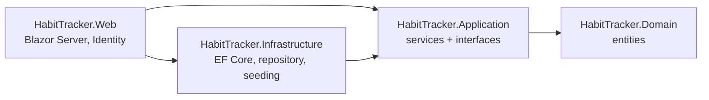
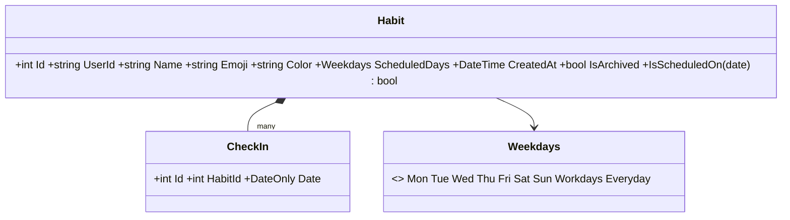
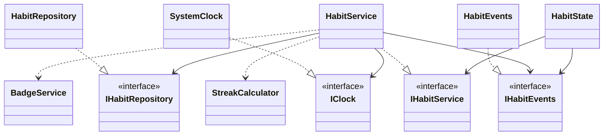
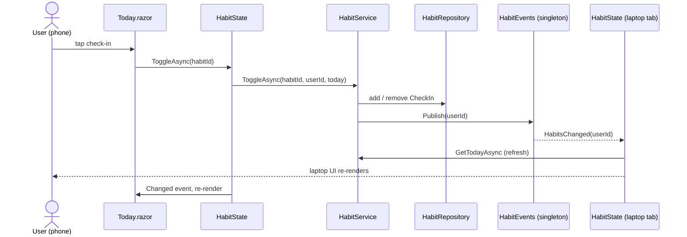
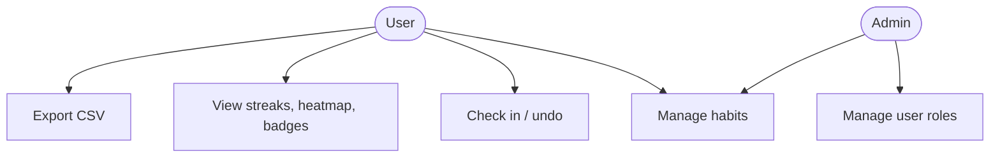

# Architecture

Pattern: **Clean Architecture** (layers) with a component-based Blazor UI. Components are the views; `HabitState` and the services act as view-model/model (an MVVM-like approach, not a framework).

## Layers

## Domain model

## Services

## Sequence: check-in with live sync

## Use cases

## Streak rules (StreakCalculator)

- Only **scheduled** days can break a streak; rest days are skipped.
- **Today never breaks** a streak while it is still open.
- A check-in on a rest day counts as a bonus and extends the streak.
- 30-day rate = completed scheduled days / scheduled days (today counted only if done).

## Technology comparison

| | **HabitFlow (ours)** | Habitica | Streaks (iOS) | Google Sheets template |
|---|---|---|---|---|
| Open code, self-hosted | ✔ | partly | ✘ | ✘ |
| Cross-platform (web + PWA) | ✔ | ✔ | iOS only | ✔ |
| Live sync between devices | ✔ | ✔ | iCloud | manual |
| Flexible weekdays per habit | ✔ | ✔ | ✔ | ✘ |
| Heatmap + badges | ✔ | gamified | ✔ | ✘ |
| No account with a third party | ✔ | ✘ | ✔ | ✘ |

| Blazor Server (chosen) | Blazor WebAssembly | MVC / Razor Pages | React + API |
|---|---|---|---|
| Full C# stack, built-in SignalR circuit (live sync), direct DB access | Works offline, but larger download and needs a separate API | Simple, little interactivity | Separate JS/TS stack and API |

## Relevance

Habit formation research shows that visible streaks and fast feedback increase consistency. A small, private, self-hosted tracker is useful for students and teams who do not want another subscription or to share personal data.
